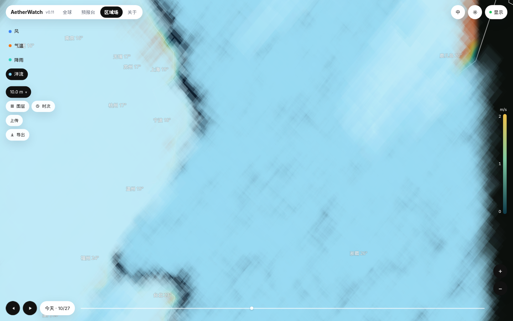

# AetherWatch 演示轻仓

*AetherWatch lite demo shell — institutional preview of global / forecast / regional fields.*

v0.11 浅色白胶囊壳。给机构客户看**全球场 / 预报台 / 区域场**的观感对标，**不抄接口、不刮第三方天气瓦片**。  
场数据只走 **FieldFrame**，默认读 `public/demo/**` 静态包，`meta.source=demo`。无 Redis、无实况上游。

设计与契约：[`DESIGN.md`](./DESIGN.md)、[`DATA-CONTRACT.md`](./DATA-CONTRACT.md)。  
锁版 tip：[`393c5165a0f0840e873d3ecfca8a9b3507b5a68a`](./SOURCE_TIP.txt)（缓流细沙）。

---

## 目的

- **给谁看**：机构客户演示。对齐「全球场 / 预报台 / 区域场」指挥壳观感，不复刻对方接口或数据协议。
- **现在用什么数据**：`public/demo/**` 静态包 → 统一 `FieldFrame`（`kind` + UV / scalar / mask + `meta.source`）。默认 `meta.source=demo`（区域洋流包为 `demo-oscar-clim`，仍属演示静态包）。
- **不做什么**：不接 OM / OSCAR / CMEMS 真源；`loadLive` 仅占位，签名与 `loadDemo` 相同。密钥、`.env`、`*.pmtiles` 不进仓。不刮 Ventusky / Windy / 高德天气瓦片。

---

## 界面

| 全球 · 风 | 预报台 · 风 |
|:---:|:---:|
|  |  |

| 区域场 · 空态 | 区域场 · 示例 NC |
|:---:|:---:|
|  |  |

截图为当前锁版：色幕在底，上面是缓流的短白线段 / 光点（不是长蛇、不是静电雪花、不是满屏刷墙）。  
要素芯片在**左下独立胶囊**（可收起），不在左上。岸线 1px `#888`。

---

## 功能（当前默认与限制）

### 四 Tab

| 路径 | 页 | 当前默认 |
|------|----|----------|
| `/global` | 全球 | 墨卡托铺满；四芯片各绑 `public/demo/global/{wind,ocean,temp,precip}`（**721×361 全球窗**，O1）。缺包灰芯片，**不回退** `regional/*` |
| `/desk`（`/forecast` 别名） | 预报台 | 东亚相机窗；四芯片绑 `demo/global/{wind,ocean,temp,precip}`，色场铺满视口。城市列表只飞相机，**不自动切城包** |
| `/regional` | 区域场 | 未上传时居中双 CTA，**不绑演示场**；上传 NC 或加载示例后东海窗 |
| `/about` | 关于 | 商业简介 + 能力列表 + 演示说明；无场；粒子暂停 |

切 Tab **保留 Map/canvas**，先 pause 粒子再换场纹理；禁止拆球 + 主线程同步 decode。切要素 ≤200ms 淡入并清空上一层残影。

### 四要素（风 · 洋流 · 气温 · 降雨）

| 要素 | 哪一页 | 现在怎么用 | 限制 |
|------|--------|------------|------|
| **风** | 全球、预报台 | 水彩色幕 α=0.5（粒子最底）+ GPGPU 细沙短线：每帧只走 1–2px，线段=上一帧→这一帧（1–3px，α=0.1–0.3，头 1px）。FBO fade **0.8**（约 0.3s 消尽）。屏上 **2–3 万**，每帧 1% 重生。全球速度 **0.05**，预报台/区域 **0.025**，`dt≤0.016` | 单帧；时间轴不切时次 |
| **洋流** | 三页芯片 | 霜蓝色幕 × mask + 更细更慢更稀的冷色 `#7FD4E8` 流线；FS `mask=0` discard，**不上陆** | 全球/预报台用 `global/ocean`；区域窗锁 `[116.5,21,132.5,36]` |
| **气温** | 三页芯片 | **256×1 LINEAR LUT** 平滑热幕，α≈0.58；粒子通道不挂载 | 禁 `mask.bin`；全球用全球包 |
| **降雨** | 三页芯片 | **低周波 fbm 雨团**，干区 α=0.02，无粒子；墨湾 / 印尼为 DEMO | 禁 `mask.bin`；全球用全球包 |

三页均有 **风 · 洋流 · 气温 · 降雨** 左下独立胶囊（全球/预报台默认风，区域默认洋流）。仅 ocean 用硬海 mask。  
页脚固定：**示例 · 单帧场（无多时次，时间轴不切换）**。顶栏无「示例数据」角标。下载按钮为壳层占位。

粒子通道**只跑 wind / ocean**。平流在 fragment 里按经纬度采 `u10/v10`，`pos += vel * dt`，禁止用速度乘大系数拉出长蛇。全球包必须是全世界窗，区域邮票不得绑到全球 Tab。

### 底图与 Firefly

- `/global`、`/desk`：轻量矢量（岸线 / 国界）+ 分级中文注记。禁止整站白天真彩。
- **仅 `/regional`** 叠 Esri World Imagery Firefly 本地 PMTiles：`public/basemap/regional/firefly.pmtiles`，z5–10，maxBounds 锁窗 + 墨蓝半透蒙版。
- `*.pmtiles` **gitignore，不进仓**。演示机执行 `pnpm generate` 私有烘焙；缺档时区域页仍走墨蓝矢量，不拉公网大图。运维可叠 `/opt/aether-demo-shell/public/basemap/regional/firefly.pmtiles`。
- 生产若直连瓦片，用环境变量 `VITE_ESRI_API_KEY`（**密钥不进仓**）。归因：Esri, Maxar, Earthstar Geographics 等。批量离线烘焙进仓或公网分发可能违 Esri ToS。

### DEMO 预热

进入全球后约 600 ms 空闲预热：全球洋流/气温/降雨、`china/*`、`regional/*`。预热失败不打断演示。切 Tab 走缓存，避免同步 decode。Global 四芯片若缺包则 404/灰显，绝不回退东海 141×131。

### 端口与运行面

服务固定 **8765**（`pnpm dev` / `pnpm preview` / Docker）。健康检查：`GET /health` → `{"status":"ok","service":"aether-demo-shell"}`。

区域场可拖放 / 选择 `.nc`（≤100MB，Worker 解析；NetCDF-4/HDF5 会明确报错，需转 classic）。未上传时**不**用演示包冒充流动。

当前演示机（Docker，nginx :80 → :8765）：

- 预报台 http://114.132.53.74/desk
- 全球 http://114.132.53.74/global
- 健康检查 http://114.132.53.74:8765/health

---

## 未来要做

- **时间轴**：区域多时次 NC → 时间轴可切帧（现单帧、轴不切换）。
- **真源**：`loadLive` 接 OM / OSCAR / CMEMS，只换 loader，不换 FieldFrame。OSCAR 后置。
- **上线**：ICP 备案完成后挂域名。

---

## 一键运行

```bash
docker compose up --build
```

浏览器：`http://<主机>:8765`。

```bash
curl -s http://127.0.0.1:8765/health
# {"status":"ok","service":"aether-demo-shell"}
```

停止：`docker compose down`。

### 本地无 Docker

Node 20+ 与 pnpm：

```bash
corepack enable
pnpm install
pnpm preview          # generate + 构建 + 8765
# 或：pnpm dev        # 同样 8765，含 /health
```

区域 Firefly 底图依赖本机 `pnpm generate` 写出 `firefly.pmtiles`（gitignore）。

### 腾讯云轻量（Ubuntu 22.04）

1. 安装 Docker 与 Compose 插件后，`git clone` 本仓，`docker compose up -d --build`。
2. 安全组 / ufw 放行 **TCP 80** 与 **TCP 8765**。
3. 访问 `http://<公网IP>:8765`。容器只暴露 Web，不含 Redis / 数据库 / 多源预热。

---

## Demo 包格式

`public/demo/<包>/`：

- `meta.json`（含 `kind`、`meta.source`）
- `u.bin` / `v.bin`：Float32 little-endian，长度 `nx*ny`，行主序 **south → north**
- 可选 `scalar.bin`（f32）、`mask.bin`（Uint8，1=海洋/有效）

前端禁止直读各源私有 JSON。重新生成：`pnpm generate`。

```
apps/web/              Vue3 + Vite + MapLibre
packages/field/        loadDemo / loadLive(stub) / parseNcFile
packages/particles/    GPU 粒子层 + LOD（风 2–3 万细沙短线 / 洋流霜蓝）
public/demo/           静态场包
docs/screenshots/      README 界面截图
```
