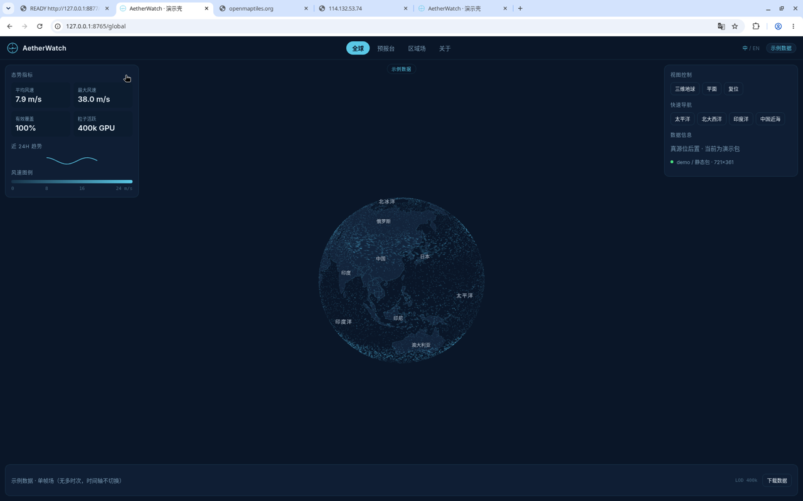
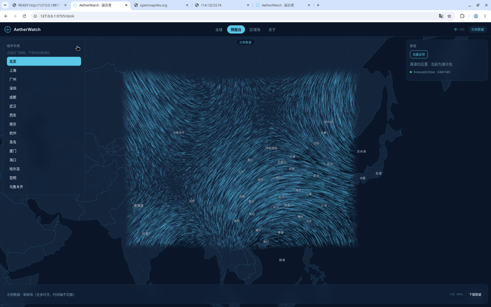
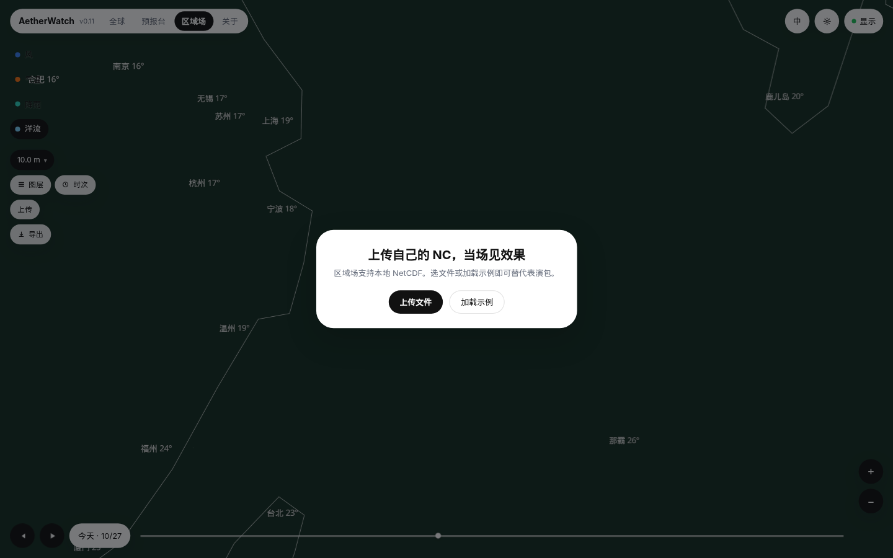
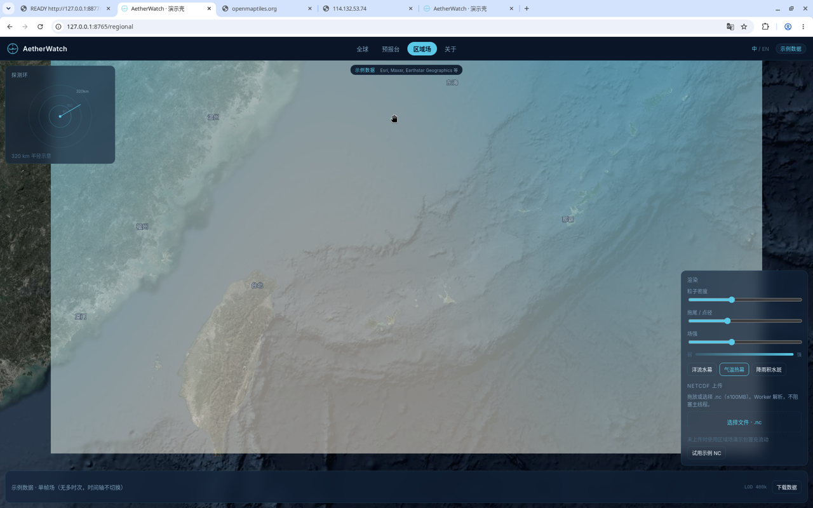

# AetherWatch 演示轻仓

*AetherWatch lite demo shell — institutional preview of global / forecast / regional fields.*

墨蓝壳 `#0a1628` + 克制青 `#5ac8e6`。给机构客户看**全球场 / 预报台 / 区域场**的观感对标，**不抄接口**。  
场数据只走 **FieldFrame**，默认读 `public/demo/**` 静态包，`meta.source=demo`。无 Redis、无实况上游。

设计与契约：[`DESIGN.md`](./DESIGN.md)、[`DATA-CONTRACT.md`](./DATA-CONTRACT.md)。  
基线 tip：[`b05163ac823d45a766a6dc730b9db87ae1d07bb7`](./SOURCE_TIP.txt)。

---

## 目的

- **给谁看**：机构客户演示。对齐「全球场 / 预报台 / 区域场」指挥壳观感，不复刻对方接口或数据协议。
- **现在用什么数据**：`public/demo/**` 静态包 → 统一 `FieldFrame`（`kind` + UV / scalar / mask + `meta.source`）。默认 `meta.source=demo`（区域洋流包为 `demo-oscar-clim`，仍属演示静态包）。
- **不做什么**：不接 OM / OSCAR / CMEMS 真源；`loadLive` 仅占位，签名与 `loadDemo` 相同。密钥、`.env`、`*.pmtiles` 不进仓。

---

## 界面

| 全球 · 风雾 | 预报台 · 全国风雾 |
|:---:|:---:|
|  |  |

| 区域场 · 洋流 | 区域场 · 气温热幕 |
|:---:|:---:|
|  |  |

截图取自 tip `b05163a` 本机演示（`127.0.0.1:8765`）。区域底图需机上 `pnpm generate` 烘焙 `firefly.pmtiles`；仓内不带该档。

---

## 功能（当前默认与限制）

### 四 Tab

| 路径 | 页 | 当前默认 |
|------|----|----------|
| `/global` | 全球 | 三维地球 + **风雾丝带**（`kind=wind`，`public/demo/global/wind`） |
| `/desk`（`/forecast` 别名） | 预报台 | 全国平面窗 + **风雾丝带**（`kind=wind`，`public/demo/forecast/china`）；城市列表只飞相机，**不自动切城包** |
| `/regional` | 区域场 | 东海窗 + **洋流水幕（仅海 mask）**（`kind=ocean`）；可切气温热幕 / 降雨积水斑 |
| `/about` | 关于 | 无场；粒子暂停 |

切 Tab **保留 Map/canvas**，先 pause 粒子再换场纹理；禁止拆球 + 主线程同步 decode。

### 四要素（风 · 洋流 · 气温 · 降雨）

| 要素 | 哪一页 | 现在怎么用 | 限制 |
|------|--------|------------|------|
| **风** | 全球、预报台 | 全球雾感细丝带（观感计数加浓，速度仍约 ×0.52） | 单帧；时间轴不切时次 |
| **洋流** | 区域场默认 | 粒子水幕 + **硬海洋 mask**；陆地 `u/v=NaN` | 单帧；窗锁 `[116.5,21,132.5,36]` |
| **气温** | 三页芯片 | **只画 scalar 热幕**；粒子 LOD=paused / count=0，禁 UV | 无细白丝；无陆地 mask 洞 |
| **降雨** | 三页芯片 | **默认积水斑**（斜条 `u_hatch` 备选）；粒子同样 paused | 无 UV 丝带 |

三页均有 **风 · 洋流 · 气温 · 降雨** 芯片（全球/预报台默认风，区域默认洋流）。仅 ocean 用硬海 mask；切气温/降雨/风时 loader 强制丢 mask。  
页脚固定：**示例 · 单帧场（无多时次，时间轴不切换）**。顶栏无「示例数据」角标。下载按钮为壳层占位。粒子全局约 ×0.52，洋流再压到约 0.4×。

### 底图与 Firefly

- `/global`、`/desk`：轻量矢量（岸线 / 国界）+ 分级中文注记。禁止整站白天真彩。
- **仅 `/regional`** 叠 Esri World Imagery Firefly 本地 PMTiles：`public/basemap/regional/firefly.pmtiles`，z5–10，maxBounds 锁窗 + 墨蓝半透蒙版。
- `*.pmtiles` **gitignore，不进仓**。演示机执行 `pnpm generate` 私有烘焙；缺档时区域页仍走墨蓝矢量，不拉公网大图。运维可叠 `/opt/aether-demo-shell/public/basemap/regional/firefly.pmtiles`。
- 生产若直连瓦片，用环境变量 `VITE_ESRI_API_KEY`（**密钥不进仓**）。归因：Esri, Maxar, Earthstar Geographics 等。批量离线烘焙进仓或公网分发可能违 Esri ToS。

### DEMO 预热

进入全球后约 600 ms 空闲预热：`forecast/china`、`regional/currents`、`regional/temp`、`regional/precip`。预热失败不打断演示。切 Tab 走缓存，避免同步 decode。

### 端口与运行面

服务固定 **8765**（`pnpm dev` / `pnpm preview` / Docker）。健康检查：`GET /health` → `{"status":"ok","service":"aether-demo-shell"}`。

区域场可拖放 / 选择 `.nc`（≤100MB，Worker 解析；NetCDF-4/HDF5 会明确报错，需转 classic）。未上传时仍用演示包冒充流动。

---

## 未来要做

- **观感**：三页粒子减速 × **0.45–0.6**，并降密（现默认偏快、偏密）。
- **要素芯片**：统一四要素芯片分型（风 / 洋流 / 气温 / 降雨），不再只在区域场右下切换 overlay。
- **角标**：顶栏「示例数据」已摘；**保留**页脚「示例 · 单帧」与 `meta.source=demo`。
- **时间轴**：区域多时次 NC → 时间轴可切帧（现单帧、轴不切换）。
- **真源**：`loadLive` 接 OM / OSCAR / CMEMS，只换 loader，不换 FieldFrame。OSCAR 后置。
- **上线**：ICP 备案完成后挂域名。

---

## 一键运行

```bash
docker compose up --build
```

浏览器：`http://<主机>:8765`。

```bash
curl -s http://127.0.0.1:8765/health
# {"status":"ok","service":"aether-demo-shell"}
```

停止：`docker compose down`。

### 本地无 Docker

Node 20+ 与 pnpm：

```bash
corepack enable
pnpm install
pnpm preview          # generate + 构建 + 8765
# 或：pnpm dev        # 同样 8765，含 /health
```

区域 Firefly 底图依赖本机 `pnpm generate` 写出 `firefly.pmtiles`（gitignore）。

### 腾讯云轻量（Ubuntu 22.04）

1. 安装 Docker 与 Compose 插件后，`git clone` 本仓，`docker compose up -d --build`。
2. 安全组 / ufw 放行 **TCP 8765**。
3. 访问 `http://<公网IP>:8765`。容器只暴露 Web，不含 Redis / 数据库 / 多源预热。

---

## Demo 包格式

`public/demo/<包>/`：

- `meta.json`（含 `kind`、`meta.source`）
- `u.bin` / `v.bin`：Float32 little-endian，长度 `nx*ny`，行主序 **south → north**
- 可选 `scalar.bin`（f32）、`mask.bin`（Uint8，1=海洋/有效）

前端禁止直读各源私有 JSON。重新生成：`pnpm generate`。

```
apps/web/              Vue3 + Vite + MapLibre
packages/field/        loadDemo / loadLive(stub) / parseNcFile
packages/particles/    GPU 粒子层 + LOD
public/demo/           静态场包
docs/screenshots/      README 界面截图
```
